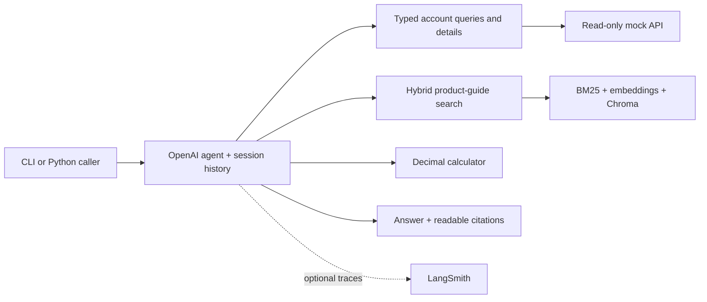
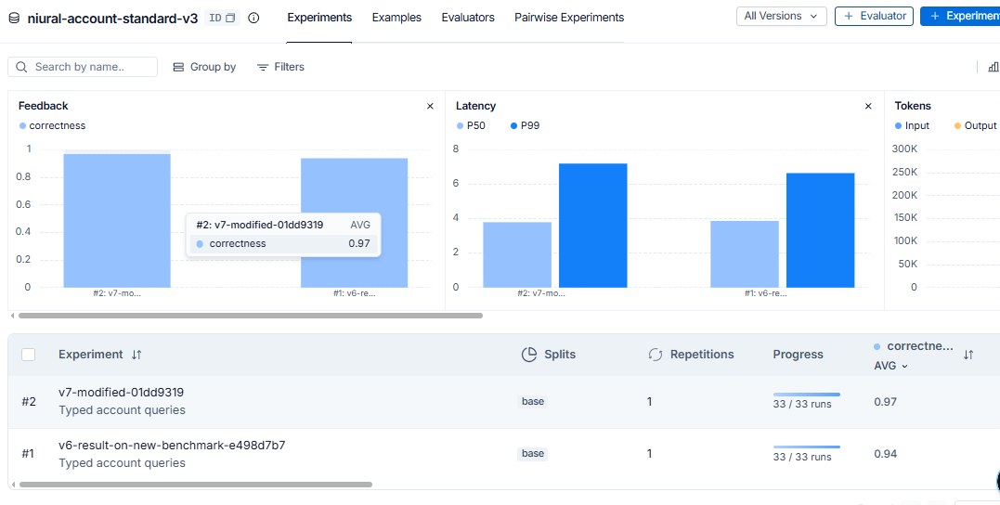
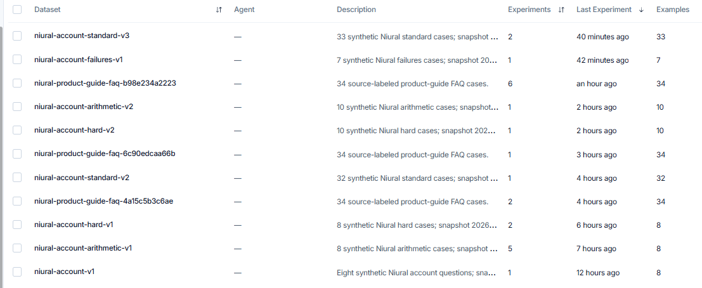

# Niural Support Agent

## Objective

Build a conversational support agent that answers Niural product and account
questions from the provided materials, cites its sources, handles corrections and
tool failures, and keeps conversations separate. All account access is read-only;
no production access is used.

The requested evaluation interface was not received, so I implemented a streaming
CLI, a Python inference API, a notebook, and separate evaluation runners. Compatibility
with Niural's private interface remains unverified until its contract is available.

## Architecture


GPT model gpt-4.1-mini-2025-04-14 is used.
The guide is split at Markdown headings into 17 sections. Search combines keyword
and vector ranks using reciprocal rank fusion, with **0.5 / 0.5 weights and top 3**
results per search. The agent can search again when evidence is missing.

## Tools and libraries

| Component | Purpose |
|---|---|
| OpenAI Agents SDK | Model/tool loop, streaming and conversation continuation |
| Pydantic | Typed queries, API records and evaluation verdicts |
| OpenAI embeddings + Chroma | Persistent semantic index |
| LangChain Markdown splitter / rank-bm25 | Heading-aware chunks / keyword matching |
| LangSmith, optional | Tool/model traces and experiment comparisons |

The agent has six tools:

| Tool | Responsibility |
|---|---|
| `query_account` | Filter, count, sum, average and sort employees, vendors and bills |
| `get_employee` | Compensation, onboarding blockers and payroll eligibility |
| `get_vendor_invoice` | Bill details and approval chain |
| `get_payment_status` | Payment result using a supplied transaction ID |
| `calculate` | Batched arithmetic with named values and Decimal rounding |
| `search_product_guide` | Product instructions and explanations with source labels |

## Setup and run

Use Python **3.11+**; the existing Conda base environment is sufficient. Run commands
from the repository root. The commands below target **v7**.

```powershell
git clone https://github.com/Abhishek5211/NiuralSupportAgent.git
cd NiuralSupportAgent
git switch v7
python -m pip install --no-cache-dir -r requirements.txt
if (!(Test-Path .env)) { Copy-Item .env.example .env }
```

Set `OPENAI_API_KEY` in root `.env`. Choose accessible `AGENT_MODEL` and `JUDGE_MODEL`
values using `.env.example`; `EMBEDDING_MODEL` controls indexing. Only root `.env`
is loaded, and credentials are excluded from Git. **No LangSmith key is required.**

Build the guide index once, then start chat:

```powershell
python -m niural_support_agent.retrieval build
python -m niural_support_agent
```

Rebuild after changing the guide or embedding model. An unchanged index is reused.
The interactive session streams answers, with tool/debug output hidden by default.
Use `/reset` to clear the session and `/quit` to exit.

For model details, tool calls and diagnostic errors:

```powershell
python -m niural_support_agent --verbose
```

## Interfaces

| Interface | Use |
|---|---|
| Streaming CLI | Interactive demonstration and unseen follow-ups |
| Python API | `await agent.ask(session_id, question)`; reuse a `SupportAgent(Config.load())` instance for follow-ups and `await agent.close()` afterward |
| `notebooks/evaluation.ipynb` | Manual inspection and evaluation walkthrough |
| Account benchmark CLI | Single-turn, multi-turn and injected-failure scenarios |
| Retrieval / answer CLIs | Isolate retrieval quality from full-agent answer quality |

The Python result contains `answer`, `error`, `usage` and `latency_ms`.


## Features implemented

- Product claims grounded in `mock_api/PRODUCT_GUIDE.md`; account facts come from
  authenticated mock API reads. Documentation examples are not customer records.
- Readable citations in answers; exact section IDs, API routes and results in traces.
- Session-scoped history, follow-up corrections and explicit city/state scope.
- Deterministic account aggregation; invoice lists include totals by currency.
- Invoice ID/number validation, structured tool errors and failure recovery.
- Support-only responses, clarification and suggested next steps when evidence is unavailable.

## Benchmarks

| Suite | Cases | Situations covered |
|---|---:|---|
| `standard` | 33 | Account lookups, dates, missing identifiers and multi-turn corrections |
| `hard` | 10 | Compound filters, reporting relationships, rankings and revised requests |
| `arithmetic` | 10 | Budgets, reserves, allocations, rounding and multi-turn changes |
| `failures` | 7 | 401/403/503/504, retry, correction after failure and timeout recovery |
| FAQ retrieval | 34 | Common, short, ambiguous and cross-section questions; 33 source-scored |
| FAQ answers | 34 | Actual agent/tool behavior: correctness, helpfulness, grounding and citations |

## LangSmith Traces



Run account suites **without LangSmith**; replace `standard` with another suite:

```powershell
python -m niural_support_agent.run_benchmark --suite standard --local --output benchmark/results/standard-review.json
```

Evaluate retrieval and full-agent answers separately:

```powershell
python -m niural_support_agent.evaluate_retriever --output benchmark/results/retrieval-review.json
python -m niural_support_agent.evaluate_answers --judge --output benchmark/results/answers-review.json
```

Retrieval reports recall@3, MRR@3 and nDCG@3. `evaluate_retriever --generate --judge`
also evaluates a passage-only generator; `evaluate_answers` runs the actual agent,
including its tool selection and repeated searches. Reference facts stay hidden
from generation. FAQ answer cases are standalone; account suites cover multi-turn behavior.

Results are saved as JSON. Local account reports include transcripts, tool calls/results,
fault events, scores and usage. Use a new output filename for each run. Account
`--no-judge` and omitting FAQ `--judge` skip grading. Model/embedding/judge calls use
the supplied OpenAI access; no evaluation starts automatically.

## LangSmith — optional

To record traces and register experiments, set root `.env`:

```ini
LANGSMITH_TRACING=true
LANGSMITH_API_KEY=your-key
```

Endpoint/workspace settings are in `.env.example`. Runs appear under
**Datasets & Experiments**, with scores and trace details. For local-only runs, set
`LANGSMITH_TRACING=false`; account `--local` overrides it without editing `.env`.
The LangSmith Python package is installed by `requirements.txt`; using its hosted
service is optional. LangChain is used for splitting, not agent orchestration.

## Versions: v1–v7

Iterations use Git branches and commits, not version folders.

| Branch | Short walkthrough |
|---|---|
| `v1` | Raw API tools; baseline exposed model counting/aggregation mistakes. Legacy Groq/OpenAI configuration. |
| `v2` | OpenAI runtime, typed account queries, Python filtering/counting/sums, streaming CLI and traces. |
| `v3` | Compensation discovery, batched detail reads, averages, sorting and optional parallel calls. |
| `v4` | Batched Decimal calculator; fixed per-operation rounding and unclear validation errors. |
| `v5` | Heading-based chunks, OpenAI embeddings, Chroma search and FAQ evaluation. |
| `v6` | BM25 + vector hybrid search; compared weights and kept equal weights for best observed recall. |
| `v7` | Customer-facing citations, grounded/support-only answers, full-agent quality evaluation and identifier/balance fixes. |

For a historical walkthrough, start from a clean checkout and choose the branch:

```powershell
git switch v4
python -m pip install --no-cache-dir -r requirements.txt
python -m niural_support_agent
```

Replace `v4` with `v1`–`v7`. Follow that branch's `.env.example` and README: older
branches have different provider settings and evaluation flags. Versions v5 onward
need the guide index for product search. See [iteration notes](docs/iterations.md)
for failures, targeted changes, traces and before/after comparisons.

## Recorded results

| Experiment | Observed result |
|---|---|
| V4 calculator revision | 8/8 arithmetic cases after rounding/error-feedback fixes |
| V5 → V6 retrieval | Recall@3: 0.907 → 0.952; MRR@3: 0.828 → 0.924 |
| V7 FAQ answers | 34/34 on all four judge dimensions |
| V7 failure scenarios | 7/7 correctness |
| V7 account suite | 32/33; one relative-date mismatch remains |

These are single-run observations, not guarantees on unseen questions. Compare
versions using the same cases, reference facts, rubric and model settings. Judge
errors were found and manually inspected; higher judge scores alone are not proof.

## Limitations

- Niural's private evaluation interface maynot be compatible.

- The mock contains one employer and assumes an employer admin is using the chatbot.
  Chat histories are separated by session; multi-employer/user authorization is not implemented.
  History lives in memory and is lost on restart.
- It desn't have  support guardrails against an escalation.
- Top-3 retrieval can miss evidence. The model can still choose incorrect filters, formulas or citations despite typed tools and exact arithmetic.

## Yet to be added

- Sandboxed Python execution for calculations beyond the current Decimal operations.
- Dedicated input/output guardrails beyond existing schema validation and prompt rules.
- Model routing by task complexity.
- Query/result caching; the document index is already persistent.
- An adapter for the supplied evaluation interface when its contract is available.

## Project map and validation

`niural_support_agent/`: runtime/tools/evaluators · `mock_api/`: schemas and fixtures ·
`benchmark/`: cases/rubrics/results · `notebooks/`: walkthrough · `docs/`: assignment and iterations.

Codex assisted with implementation, prompts and case drafting. Outputs were checked
against fixture/API/guide evidence, offline checks and execution traces, with manual
review of disputed judge results. Detailed references: [benchmarks](benchmark/README.md),
[iterations](docs/iterations.md), [assignment](docs/assignment/Task.txt).
