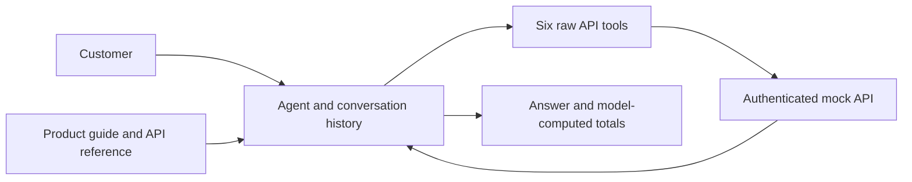
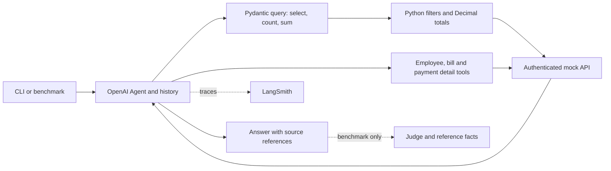

# Support Agent Iterations

- **Goal:** Answer account questions accurately using authenticated, read-only tools.
- **Versions:** Git branches `v1` (baseline) and `v2` (current).
- **Latest measured result:** V2 hard benchmark **7/8 correct (87.5%)**. [Hard export](../benchmark/results/v2-hard-8e6c80b8.csv)
- **Data snapshot:** 2026-09-28; all counts and dates below use this snapshot.

## V1 - Raw API tools

- **Problem:** The model counted and summed raw records itself; a recorded headcount observation was 17 instead of 16 active workers.
- **Approach:** Established a baseline with employee, vendor, bill and transaction list/detail tools.
- **Result:** No complete V1 benchmark score is available; the counting observation is not an aggregate accuracy score.
- **Scope correction:** The expected active population is **14 employees + 2 contractors = 16 workers**, not 16 employee-type records. [Standard case 1](../benchmark/cases.json)
- **Solution carried into V2:** Move filtering, counting and monetary sums into validated Python execution.

## V2 - Structured account queries

- **Problem -> solution:** Counting/sum errors -> `query_account` uses validated filters, Python counts and Decimal sums grouped by currency.
- **Problem -> solution:** Vendor contacts and employee fields were omitted from the tool catalog -> expose available list fields and re-query omitted projections on follow-up.
- **Problem -> solution:** Difficult interaction/debugging -> streaming CLI, tool events and optional LangSmith traces/experiments.
- **Problem -> solution:** Basic cases missed compound failures -> add eight self-contained hard questions with independently verified reference facts. [Hard cases](../benchmark/hard_cases.json), [verification notes](../benchmark/README.md)
- **Current scope:** Account tools only; product-document RAG is planned and is not part of these benchmark results.

### Historical standard benchmark

- **Result:** **6/8 correct (75%)**, as exported; experiment `v2-query-tools-604925f7`. [Standard export](../benchmark/results/v2-query-tools-604925f7.csv)
- **Case 2:** Asked whether New York meant city or state; scored unresolved because no factual answer was provided.
- **Case 8:** Answered the freight failure correctly; prior review identified a judge false rejection because supported extra details exceeded the short reference answer. Preserve the exported 6/8 score.
- **Comparison limit:** Case 8 received an injected transaction ID. Current code no longer injects context based on case ID, so this historical scenario must be explicitly rebaselined before comparison.

### New hard benchmark

- **Result:** **7/8 correct (87.5%)**; experiment `v2-hard-8e6c80b8`; one repetition per case. [Hard export](../benchmark/results/v2-hard-8e6c80b8.csv)
- **Recorded answering model:** `gpt-5.4-mini-2026-03-17`.
- **Recorded judge:** `gpt-4.1-mini-2025-04-14`; this is the exported run's judge, regardless of current configuration defaults.
- **Execution:** All eight runs completed successfully; the one failed correctness verdict was not a runtime error.
- **Mean exported latency:** **19.44 seconds per case**.

| Case | Coverage | Exported result |
|---|---|---|
| 1 | Vendor contacts, filters, unpaid/overdue totals | Pass; USD 15,792.40 unpaid and USD 15,270.00 overdue |
| 2 | Employee filters, five salary lookups, salary ordering | Fail; correct five-person roster, but salaries and ordering omitted |
| 3 | Similar bills, paid/unpaid distinction, current approver | Pass; USD 2,750.00 still owed for the pair; USD 8,400.00 awaiting Beatrix |
| 4 | Corrected NY-state scope, onboarding, stored CA contractor location | Pass; five active employees, no active contractors and one pending hire in NY |
| 5 | Direct versus one-level-indirect reporting relationships | Pass; nine direct reports, one indirect; six active employees and two active contractors |
| 6 | Manager/team lookup, onboarding and dismissal dates | Pass; Lucas has zero other onboarded teammates under Desmond |
| 7 | Missing manager assignments and direct-report counts | Pass; three onboarded employees with no assigned manager |
| 8 | Inclusive due-date window, contacts, approval owners and totals | Pass; USD 9,380.00 pending approval + USD 10,700.00 scheduled = USD 20,080.00 |

- **Remaining problem:** Case 2 claimed salary was unavailable after using list data; compensation is available through employee detail records. [Employee detail API](../mock_api/API_DOCUMENTATION.md#2-get-employee)
- **Proposed solution:** Describe compensation explicitly in `get_employee` guidance; require detail lookups for salary requests, then order the retrieved annual USD amounts. This fix has not been benchmarked.
- **Measurement limit:** The standard and hard suites contain different questions. Their 75% and 87.5% scores do not establish a before/after improvement; no comparable V1 suite score exists.

## Next iteration

- Fix the salary-detail lookup failure and rerun hard case 2, then the full hard suite for regressions.
- Keep cases, reference facts, model settings and judge fixed for a controlled comparison; record the Git revision.
- Review disputed judge decisions against tool evidence without silently changing exported scores.
- Add section-based product RAG as a separate iteration, with its own FAQ/retrieval benchmark.

## Arithmetic baseline before V3

- Add eight hypothetical arithmetic cases using existing account data, without
  changing v2 agent instructions, tools, models, turn limits or the judge rubric.
- Cases cover reserves/payroll, vendor prioritization, mean salaries and raises,
  discounts/fees, contractor budgeting, runway, proportional allocation and margin.
- Reference facts are checked; agent score and failure analysis are pending a
  manually started `--suite arithmetic --name v2-arithmetic-baseline` run.
- Capture the v2 baseline before adding sorting, arithmetic and salary-detail
  guidance on v3. Compare identical cases and settings; retain traces and review
  any regressions. Product-guide vector search remains a separate v4 iteration.

## V3 - compensation queries and controlled parallel calls

- Preserve the user's 15-turn limit on v2 before creating v3.
- First commit: describe compensation in get_employee so salary/rate discovery
  can be evaluated separately from batching.
- Second commit: query_account fetches compensation details for list-filtered
  workers internally, then applies compensation filters, Decimal sums/averages
  and stable sorting. It retains detail sources and fails on missing required data.
- Third commit: make independent parallel tool calls opt-in through root .env;
  record the actual setting, turn limit and timeout in experiment metadata.
- Reference arithmetic export a58a8ee1: 4/8 correct; cases 1/6 reached the model-turn
  limit and cases 3/5 incorrectly declared compensation unavailable. The four other
  cases passed. The reported successful higher-limit retry is not in that export.
- V3 scores, call reductions and regressions remain unmeasured. Run the unchanged
  arithmetic and hard suites manually with matching models and limits. Compare
  parallel disabled/enabled separately; a changed limit is a different baseline.
- Calculator and product-guide search remain deferred. No paid runs are automatic.

## V3 measured arithmetic results

- Original prompt: experiment v3-arithmetic-discovery-batch-calc-f1174c03 scored
  7/8. The name included calc, but revision 3b1a103 had no calculator. All eight
  completed; parallel calls were false and max_turns was 15. Total tokens 119,701;
  mean exported latency 12.18 seconds. Earlier v2 scored 4/8 with 142,606 tokens
  and 13.06 seconds mean latency, but its lower turn limit confounds attribution.
- Case 7 regressed: correct balances were retrieved, but Orrery received $703.55
  instead of $703.43 and the residual allocation to Pallas was $0.12 too low.
  Its trace showed eight tool calls: a sum/select-fields validation error, exact
  matching of short names, AND-combined name filters, individual vendor lookups,
  then a correct aggregate. A calculator does not fix those query decisions.
- Compensation batching was inconsistent: case 3 retrieved five salaries in one
  query, but case 1 queried each worker separately. Case 3 calculated its average
  in the model rather than invoking the average operation.
- Shortened prompt: experiment v3-arithmetic-discovery-batch-calc-short-prompt-10806082
  scored 6/8. Case 6 treated $2,627.60 of spendable cash as total remaining cash,
  incorrectly claiming a reserve shortfall; actual cash was $42,627.60, including
  the $40,000 reserve. Case 7 allocated $773.60 instead of $773.78 to Sable and
  shifted $0.18 to Pallas. These are substantive errors, not rounding-mode ties.
- Both exports use identical questions/reference facts and the same answering/judge
  model names. Each has one repetition; this does not establish that prompt trimming
  caused the regression. The shortened prompt is now preserved as commit 51f928f.

## V4 - generic batched Decimal calculator

- Hypothesis: one typed calculation batch can make scenario arithmetic and rounding
  reproducible, especially proportional allocation, with one calculator invocation
  instead of separate calls for every operation.
- Add request-local named variables and ordered arithmetic steps. Use decimal strings,
  a 50-significant-digit Decimal context, explicit rounding modes/places, earlier-step
  references and structured results/errors. No expression language or code execution.
- Keep account tools, models, benchmarks, judge rubric, 15-turn limit and parallel
  setting unchanged. The prompt only adds calculator-use/rounding guidance. Product
  guide retrieval remains deferred; v4 now refers to the calculator iteration.
- Offline checks cover the exact allocation and reserve calculations, half-up versus
  half-even ties, negative values, ceiling/floor, dependent steps and invalid requests.
  These are implementation checks, not measured agent success. No test files or paid
  runs are created automatically.
- Agent results are pending. Manually run the unchanged arithmetic suite as
  v4-arithmetic-calculator; review cases 6/7 and check all eight for regressions.
  Compare correctness, model requests, calculator calls, tokens and latency in
  LangSmith. Calculator results remain derived from account sources/user assumptions.
- Keep/rollback decision is pending. Execution is deterministic for the supplied
  steps, but the model can still choose incorrect formulas or inputs; the reserve
  interpretation failure may persist. Tool-schema tokens and an additional model
  turn may also offset savings. Do not claim resolution before inspecting traces.

### V4 follow-up: rounding and validation feedback

- Run 3d024296 exported 6/8; manual review found 5/8 because case 6 was falsely
  accepted. Case 3 exhausted 15 turns after five lookups and ten calculator calls.
- Cause: rounding attached to divide/multiply was rejected; generic 422 messages
  hid the reason. Case 8 also retried this mistake three times.
- Change: allow explicit rounding on any operation. Require both places and mode;
  round the result once, before later steps reference it. Standalone round remains.
- Change: calculator validation errors now identify the step and actual problem,
  including when the SDK redacts its validation exception.
- Offline checks only; no evaluation run. Compare the unchanged suite/settings
  manually. Formula selection, contradictory answers and judge errors remain open.

### V4 measured result

Run 7afa7ef5 (code 556b162), compared with 3d024296; same cases, models and limits.

| Metric | Before | After |
|---|---:|---:|
| Exported correctness | 6/8 | 8/8 |
| Tokens | 264,641 | 202,534 (-23.5%) |
| Mean latency | 18.79 s | 15.80 s (-16%) |

- Manual review agrees with 8/8; the earlier judge falsely passed case 6.
- Case 3: 10 calculator calls became one. Case 8: four became one; rounding retries disappeared.
- Keep the fixes. One run is not a reliability guarantee; case 7 still needed more calls.
- Next: V5 product-guide RAG, starting with FAQ evaluation and cited section retrieval. No new eval was run.

### V5: FAQ baseline before retrieval

- Add 20 guide-grounded questions: common tasks, unusual wording, exact UI keywords
  and missing-information cases. Keep facts and expected source headings separate.
- Verified every case twice against the full guide; examples are not account facts,
  fee amounts are not invented, and unsupported procedures require acknowledging gaps.
- Use the same cases for semantic and later hybrid retrieval. Map headings to chunks
  after splitting; evaluate retrieval and generation separately. No live eval ran.

### V5: Markdown chunking

- LangChain splits the cleaned guide at `#`/`##`; `###` subsections, tables and lists
  stay together. No overlap or size-based split is needed for this guide.
- 17 typed chunks; stable filename/heading IDs and heading-prefixed embedding text.
  All 20 FAQ source labels map to chunks. Verified locally; no inference/eval ran.
- Next: embed these chunks and store them in Chroma. Retrieval is not implemented yet.

- Extend the FAQ set to 30 with ten short queries (21-30), including Unlinked,
  KYB, DOCX uploads and an ambiguous i 99 typo. Source-checked; original 20 unchanged.

### V5: vector retrieval and manual evaluation

- OpenAI embeddings + persistent local Chroma cosine search; reuse the 17 chunks.
  Build is explicit, unchanged indexes are reused, and stale/missing indexes fail
  clearly. Add search_product_guide; account data remains authoritative for accounts.
- Add manual retrieval evaluation for all 30 FAQs: source hits/rank/coverage, timings,
  embedding usage and full results. Optional LLM judges grade passage relevance and
  sufficiency; optional passage-based answers are judged separately for correctness,
  grounding, helpfulness and citations. Gold facts never reach the generator.
- No live ingestion or eval ran. Metrics are unmeasured; similarity is not confidence,
  source hits do not establish answer quality, and judge failures remain ungraded.
  Hybrid search and reranking remain later comparisons.

- Simplify retrieval scoring to deterministic recall@3, MRR@3 and binary nDCG@3
  from existing section labels. Keep optional LLM judgments separate; no new
  dependencies or live eval. Alternative/candidate labels measure source retrieval,
  not whether the answer is sufficient.

- Add FAQ cases 31-34 requiring 2-4 sections; preserve the original 30. Save missing
  section labels. Case 34 exposes the top-3 ceiling (maximum recall 0.75); the full
  chat can search again, while this evaluator retrieves once. No live eval ran.

- Register FAQ runs as LangSmith experiments when tracing is enabled. Reuse a
  content-hashed dataset; publish existing metrics/judgments as feedback without
  extra model calls. Keep JSON and its experiment link. No live eval/upload ran.

- Tighten retrieval judging: every requested part needs passage evidence; reference
  facts cannot fill gaps. Grade expected limitations/clarifications as valid outcomes.
- Separate required sections from any-one alternative groups; alternatives earn one
  coverage credit. Case 23 uses alternatives; remove unnecessary labels in 15/27.
  Labels create a new LangSmith snapshot (rubric faq-evidence-v2); old scores are not
  directly comparable. Retrieval/generation unchanged; no live eval or upload ran.

- Add expected_behavior and minimum required_facts to all 34 FAQs. Judges use only
  this checklist; optional reference prose stays out of judge/generator prompts.
  Retrieval sufficiency follows per-fact support with evidence, including valid No,
  clarification and unavailable responses. Cases 8/15 drop extra source requirements;
  23/25/27 accept clarification or conditional guidance. Case 24 needs no source and
  is unscored for retrieval (33 labeled cases). New rubric: faq-behavior-v3.
  Retrieval and generator unchanged. Offline checks only; no live eval/upload ran.

### V5 wrap-up: semantic FAQ baseline

- [Saved run](../benchmark/results/faq-behavior-v3.json): 34 cases; 33 retrieval-scored.
  Recall@3 0.907, MRR@3 0.828, nDCG@3 0.843; no retrieval errors; mean retrieval 441ms.
- Judge reports sufficiency 30/34. Manual review: 24 is a false negative; 19/33
  incorrectly pass missing scope/transaction evidence. This is an imperfect judge.
- Real misses remain: bill notes (29), DOCX contract evidence (32), and transaction
  evidence (33/34). Four required sections in 34 exceed the fixed top-3 budget.
- Keep the behavior/checklist rubric; no generator evaluation was run. Earlier
  scores use different labels/rubrics and are not directly comparable.
- Next: v6 hybrid keyword + vector search. Compare the same cases/rubric and top-3
  budget first; inspect coverage and regressions. Keep judge caveats visible.

### V6: hybrid retrieval

- Add BM25 keyword ranking and equal-weight reciprocal rank fusion (constant 60).
  Both rank all 17 sections locally/from Chroma; only the final top 3 reach the model.
  Reuse embeddings/index; still one query embedding. Save component ranks and scores.
- Same FAQ cases, behavior rubric, generator and judge; no benchmark-specific tuning.
  Compare against the v5 saved run, retaining known judge caveats. Offline checks
  only; no live embeddings, generator/judge calls or evaluation run.

- Expose VECTOR_WEIGHT/KEYWORD_WEIGHT as hybrid.py constants (0.5 each). Save both
  in eval metadata; equal defaults preserve ranking and halve prior raw RRF scores.
  Same benchmark/top 3; no .env changes or live evaluation run.

### V6 wrap-up: keep equal weights

Same 34 FAQ cases (33 retrieval-scored), rubric and top 3; one run per setting.

| Vector / keyword | Recall@3 | MRR@3 | nDCG@3 |
|---|---:|---:|---:|
| 0.5 / 0.5 | **0.952** | 0.924 | 0.925 |
| 0.4 / 0.6 | 0.942 | 0.934 | **0.931** |
| 0.55 / 0.45 | 0.937 | 0.924 | 0.915 |
| 0.6 / 0.4 | 0.937 | **0.939** | 0.927 |

- Keep 0.5/0.5 for best observed coverage; it does not win every metric or prove a
  general optimum. V5 recall/MRR/nDCG were 0.907/0.828/0.843 under the same rubric.
- Results: [equal](../benchmark/results/faq-hybrid-v6.json), [0.4](../benchmark/results/faq-hybrid-vec-0.4-v6.json), [0.55](../benchmark/results/faq-hybrid-vec-0.55-v6.json), [0.6](../benchmark/results/faq-hybrid-vec-0.6-v6.json).
  Equal baseline used implicit 1/1, equivalent in ranking to 0.5/0.5. No run errors.
- Judge sufficiency remains unreliable (19/33/34 false positives, 24 false negative
  in the equal run). These are retrieval experiments; no generator quality measured.
- Next, V7: readable source headings in customer answers, exact references in traces;
  answer first, useful next step, concise natural wording, one focused clarification.
  Evaluate full-agent answers/conversations for correctness, grounding, citation
  accuracy and helpfulness on the same cases, recording latency/tokens and failures.

### V7: customer-facing answers

- Add readable citation_label fields; retain exact guide IDs/API references in tool
  outputs/traces. Shared style: answer first, natural wording, useful next step,
  focused clarification, no internal citation clutter. Retrieval stays at 0.5/0.5/top 3.
- Add manual full-agent FAQ evaluation: same 34 questions, fresh sessions and actual
  tool evidence. One optional judge grades correctness/helpfulness/grounding/citations
  (customer-answers-v1); save JSON and LangSmith feedback, usage and answer latency.
- This measures standalone answers, not multi-turn account quality. Keep component
  retrieval evaluation separate. Offline checks only; no eval/model/upload calls.
