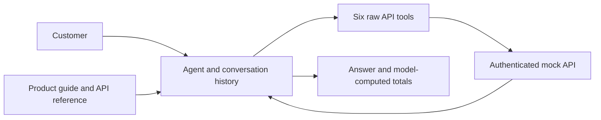
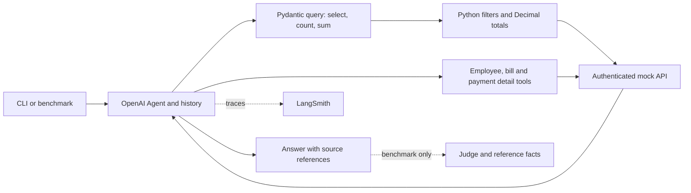

# Support Agent Iterations

- **Goal:** Answer account questions accurately using authenticated, read-only tools.
- **Versions:** Git branches `v1` (baseline) and `v2` (current).
- **Latest measured result:** V2 hard benchmark **7/8 correct (87.5%)**. [Hard export](../benchmark/results/v2-hard-8e6c80b8.csv)
- **Data snapshot:** 2026-09-28; all counts and dates below use this snapshot.

## V1 - Raw API tools

- **Problem:** The model counted and summed raw records itself; a recorded headcount observation was 17 instead of 16 active workers.
- **Approach:** Established a baseline with employee, vendor, bill and transaction list/detail tools.
- **Result:** No complete V1 benchmark score is available; the counting observation is not an aggregate accuracy score.
- **Scope correction:** The expected active population is **14 employees + 2 contractors = 16 workers**, not 16 employee-type records. [Standard case 1](../benchmark/cases.json)
- **Solution carried into V2:** Move filtering, counting and monetary sums into validated Python execution.

## V2 - Structured account queries

- **Problem -> solution:** Counting/sum errors -> `query_account` uses validated filters, Python counts and Decimal sums grouped by currency.
- **Problem -> solution:** Vendor contacts and employee fields were omitted from the tool catalog -> expose available list fields and re-query omitted projections on follow-up.
- **Problem -> solution:** Difficult interaction/debugging -> streaming CLI, tool events and optional LangSmith traces/experiments.
- **Problem -> solution:** Basic cases missed compound failures -> add eight self-contained hard questions with independently verified reference facts. [Hard cases](../benchmark/hard_cases.json), [verification notes](../benchmark/README.md)
- **Current scope:** Account tools only; product-document RAG is planned and is not part of these benchmark results.

### Historical standard benchmark

- **Result:** **6/8 correct (75%)**, as exported; experiment `v2-query-tools-604925f7`. [Standard export](../benchmark/results/v2-query-tools-604925f7.csv)
- **Case 2:** Asked whether New York meant city or state; scored unresolved because no factual answer was provided.
- **Case 8:** Answered the freight failure correctly; prior review identified a judge false rejection because supported extra details exceeded the short reference answer. Preserve the exported 6/8 score.
- **Comparison limit:** Case 8 received an injected transaction ID. Current code no longer injects context based on case ID, so this historical scenario must be explicitly rebaselined before comparison.

### New hard benchmark

- **Result:** **7/8 correct (87.5%)**; experiment `v2-hard-8e6c80b8`; one repetition per case. [Hard export](../benchmark/results/v2-hard-8e6c80b8.csv)
- **Recorded answering model:** `gpt-5.4-mini-2026-03-17`.
- **Recorded judge:** `gpt-4.1-mini-2025-04-14`; this is the exported run's judge, regardless of current configuration defaults.
- **Execution:** All eight runs completed successfully; the one failed correctness verdict was not a runtime error.
- **Mean exported latency:** **19.44 seconds per case**.

| Case | Coverage | Exported result |
|---|---|---|
| 1 | Vendor contacts, filters, unpaid/overdue totals | Pass; USD 15,792.40 unpaid and USD 15,270.00 overdue |
| 2 | Employee filters, five salary lookups, salary ordering | Fail; correct five-person roster, but salaries and ordering omitted |
| 3 | Similar bills, paid/unpaid distinction, current approver | Pass; USD 2,750.00 still owed for the pair; USD 8,400.00 awaiting Beatrix |
| 4 | Corrected NY-state scope, onboarding, stored CA contractor location | Pass; five active employees, no active contractors and one pending hire in NY |
| 5 | Direct versus one-level-indirect reporting relationships | Pass; nine direct reports, one indirect; six active employees and two active contractors |
| 6 | Manager/team lookup, onboarding and dismissal dates | Pass; Lucas has zero other onboarded teammates under Desmond |
| 7 | Missing manager assignments and direct-report counts | Pass; three onboarded employees with no assigned manager |
| 8 | Inclusive due-date window, contacts, approval owners and totals | Pass; USD 9,380.00 pending approval + USD 10,700.00 scheduled = USD 20,080.00 |

- **Remaining problem:** Case 2 claimed salary was unavailable after using list data; compensation is available through employee detail records. [Employee detail API](../mock_api/API_DOCUMENTATION.md#2-get-employee)
- **Proposed solution:** Describe compensation explicitly in `get_employee` guidance; require detail lookups for salary requests, then order the retrieved annual USD amounts. This fix has not been benchmarked.
- **Measurement limit:** The standard and hard suites contain different questions. Their 75% and 87.5% scores do not establish a before/after improvement; no comparable V1 suite score exists.

## Next iteration

- Fix the salary-detail lookup failure and rerun hard case 2, then the full hard suite for regressions.
- Keep cases, reference facts, model settings and judge fixed for a controlled comparison; record the Git revision.
- Review disputed judge decisions against tool evidence without silently changing exported scores.
- Add section-based product RAG as a separate iteration, with its own FAQ/retrieval benchmark.

## Arithmetic baseline before V3

- Add eight hypothetical arithmetic cases using existing account data, without
  changing v2 agent instructions, tools, models, turn limits or the judge rubric.
- Cases cover reserves/payroll, vendor prioritization, mean salaries and raises,
  discounts/fees, contractor budgeting, runway, proportional allocation and margin.
- Reference facts are checked; agent score and failure analysis are pending a
  manually started `--suite arithmetic --name v2-arithmetic-baseline` run.
- Capture the v2 baseline before adding sorting, arithmetic and salary-detail
  guidance on v3. Compare identical cases and settings; retain traces and review
  any regressions. Product-guide vector search remains a separate v4 iteration.

## V3 - compensation queries and controlled parallel calls

- Preserve the user's 15-turn limit on v2 before creating v3.
- First commit: describe compensation in get_employee so salary/rate discovery
  can be evaluated separately from batching.
- Second commit: query_account fetches compensation details for list-filtered
  workers internally, then applies compensation filters, Decimal sums/averages
  and stable sorting. It retains detail sources and fails on missing required data.
- Third commit: make independent parallel tool calls opt-in through root .env;
  record the actual setting, turn limit and timeout in experiment metadata.
- Reference arithmetic export a58a8ee1: 4/8 correct; cases 1/6 reached the model-turn
  limit and cases 3/5 incorrectly declared compensation unavailable. The four other
  cases passed. The reported successful higher-limit retry is not in that export.
- V3 scores, call reductions and regressions remain unmeasured. Run the unchanged
  arithmetic and hard suites manually with matching models and limits. Compare
  parallel disabled/enabled separately; a changed limit is a different baseline.
- Calculator and product-guide search remain deferred. No paid runs are automatic.
